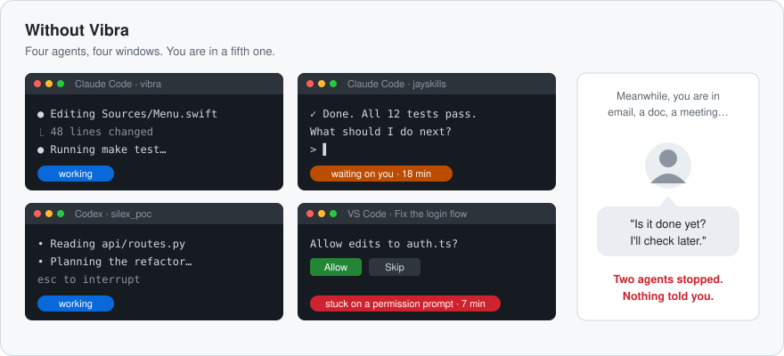
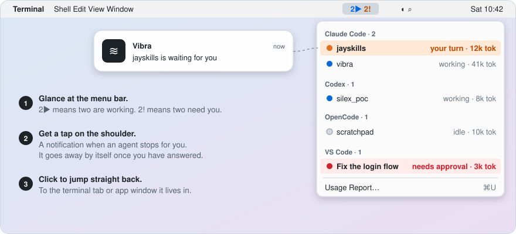
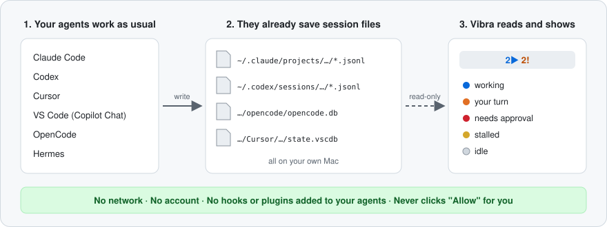

<h1 align="center">📳 Vibra</h1>

<p align="center">
  <strong>AI コーディングエージェントは 10 分前に作業を終えています。気づいていましたか？</strong>
</p>

<p align="center">
  <a href="LICENSE"></a>
  <a href="#インストール"></a>
  <a href="docs/development.md"></a>
  <a href="#プライバシー"></a>
  <a href="https://github.com/silex-ai-lab/silex_vibra/stargazers"></a>
</p>

<p align="center">
  <a href="#問題">問題</a> · <a href="#クイックスタート">クイックスタート</a> · <a href="#対応エージェント">対応エージェント</a> · <a href="#プライバシー">プライバシー</a>
  <br>
  <a href="README.md">English</a> · <a href="README.zh-CN.md">简体中文</a> · 日本語 · <a href="README.ko.md">한국어</a>
</p>

---

英語版 README が正式な内容です。この翻訳は遅れる場合があります。

## 問題

Claude Code にタスクを任せ、作業している間に別のことを始めます。続けて
Codex に 2 つ目のタスクを渡し、VS Code の Copilot に 3 つ目を頼むこともあるでしょう。
その後、たいていこうなります。

- **あるエージェントは 3 分で終わったのに、あなたが見に戻ったのは 20 分後。**
  そのうち 17 分間、エージェントは何もせずに待っていました。
- **別のエージェントは 30 秒で止まり、「このファイルを編集してもいいですか？」と尋ねている。**
  あなたが答えるまで何も進みません。そして、その質問に気づくのはずっと後です。
- **確かめるには、ターミナルのタブやウィンドウを全部クリックして回るしかない。**
  1 つずつ、1 時間に何度も。

<p align="center">
  
</p>

エージェントがクラッシュして失敗することはめったにありません。失敗するのは、
あなたが見ていないウィンドウで黙って待っているときです。同時に動かすエージェントが
増えるほど、こうして失う時間も増えていきます。

## Vibra がどう解決するか

Vibra は Mac のメニューバーに常駐する、小さな無料アプリです。すべてのエージェントの
セッションを見守り、どれかがあなたを必要とした時点ですぐに知らせます。

<p align="center">
  
</p>

| 問題 | Vibra があると |
|---|---|
| 😴 エージェントが終わったのに気づかなかった | その行が 🟠 **your turn**（あなたの番）になり、通知が届きます。あなたが応答すると通知は消えます。 |
| ✋ エージェントが「許可しますか？」で止まっている | その行が 🔴 **needs approval**（承認が必要）になります。Vibra は表示するだけで、あなたに代わって Allow をクリックすることはありません。 |
| 🔎 目的のタブを探して回っている | 行または通知をクリックすると、そのターミナルタブやアプリのウィンドウに移動します。 |
| 👀 どのエージェントがまだ動いているかわからない | メニューバーを見ればひと目でわかります。`2▶` は 2 つが作業中、`2!` は 2 つがあなたを待っているという意味です。 |
| 🧾 これだけの作業で何を使ったのか気になる | **Usage Report…**（⌘U）が 7 日分のトークンと、API 料金で換算した場合の金額を表示します。 |
| 🛡️ エージェントがあなたの許可なく何かをした | **Review Agent Activity…** は、拒否されたのに後から実行された呼び出し、認証情報の読み取り、ワークスペース外への書き込み、強制プッシュ、制限なしで実行されたセッションを一覧にします。それぞれにあなたが答えるか、ベンダーへの報告書を下書きして、あなた自身で送信できます。 |

すべてのエージェントがすべての状態を報告するわけではなく、移動できないエージェントもあります。
各エージェントで何が使えるかは [対応エージェント](#対応エージェント) の表にまとめています。

> ⭐ **このリポジトリに Star を**。新しいエージェントへの対応や修正を見逃しません。エージェントがセッションファイルを変えたら Vibra 側で追従するので、あなたが追いかける必要はありません。[Star する価値 →](#-star-する価値)

## しくみ

これらのエージェントは、もともと会話を Mac 上のファイルに保存しています。Vibra は
そのファイルを読み取り専用で読み、各セッションがどの状態にあるかを判断します。
やっていることはそれだけです。ネットワークには何も送らず、エージェントにも何もインストールしません。

<p align="center">
  
</p>

### ✅ インストール前に

| | |
|---|---|
| 💰 **無料でオープンソース** | Apache License 2.0。 |
| 🔒 **ローカル専用** | ネットワーク送信は一切ありません。アカウントなし、テレメトリなし、更新確認なし。 |
| 🧩 **エージェントに何もインストールしない** | フック、プラグイン、ステータスライン、ラッパーバイナリはありません。 |
| 🤖 **6 つのエージェント** | Claude Code、Codex、Cursor、VS Code（Copilot Chat）、OpenCode、Hermes。すべてのエージェントがすべての状態を報告できるわけではありません。詳細は [対応エージェント](#対応エージェント)。 |
| 🩺 **セルフチェック** | クローンしたリポジトリで `make probe` を実行すると、セッションと状態が表示されます。メッセージ内容は表示しません。 |
| ⚠️ **ソースからビルド** | ダウンロードできるアプリはまだありません。Vibra は ad-hoc 署名で公証されていないため、通知には「システム設定」での手動操作が 1 回必要です。 |

## クイックスタート

### インストール

#### Homebrew

Vibra は [Apache-2.0 ライセンス](LICENSE)に基づき、誰でも無料でインストールして使用できます。
このリポジトリと公式 tap は公開されています。GitHub アカウント、招待、リポジトリへのアクセス承認は不要です。

Apple Silicon と Intel Mac に対応しています。CI はプッシュのたびに、macOS 15 と Swift 6.1.2 を使い、Apple Silicon と Intel の両方でアプリをビルド、テスト、起動しています。インストール前に `swift --version` で Swift 6.1 以降であることを確認してください。
Swift がない場合は `xcode-select --install` を実行し、古い場合は「ソフトウェアアップデート」で Command Line Tools を更新してください。

[Homebrew](https://brew.sh)、macOS 14 以降、Swift 6.1 以降が必要です。

```sh
brew install silex-ai-lab/tap/vibra
open "$(brew --prefix vibra)/Vibra.app"
```

[公式 tap](https://github.com/silex-ai-lab/homebrew-tap) は SHA-256 で検証したソースを Mac 上でビルドします。
Command Line Tools で十分で、Xcode 全体は不要です。`vibra --query` コマンドも使えます。

起動前に古い Vibra を終了してください。Homebrew は `/Applications/Vibra.app` やログイン項目を変更しません。
このビルドは ad-hoc 署名で、公証されていません。[移行と署名の注意事項](https://github.com/silex-ai-lab/homebrew-tap#switch-from-a-manual-installation)を確認してください。

更新の前に Vibra を終了し、`brew upgrade silex-ai-lab/tap/vibra` を実行してください。
Vibra と保存データを削除するには、[Vibra の削除](#vibra-の削除) を参照してください。

#### ソースから手動でビルド

**macOS 14 以降** と Swift 6.1 以降が必要です。**Xcode は不要です。**
Command Line Tools で十分です。

```sh
xcode-select --install     # skip if `swift --version` already works
```

次に、以下を実行します。

```sh
git clone https://github.com/silex-ai-lab/silex_vibra.git
cd silex_vibra
make install               # builds, then copies to /Applications
open /Applications/Vibra.app
```

`make install` は実行中のコピーを先に終了するので、変更を取り込んだ後に
再実行しても安全です。

Vibra には Dock アイコンがありません。**すべてメニューバーの項目から始まり**、Setup、
Session Details、Review Agent Activity などのウィンドウはそのメニューから開きます。
メニューバーの右側で `Vibra`、またはセッションが動いているときは `2▶ 1!` のような
カウントを探してください。

### Vibra の削除

まず Vibra を終了します。次に、インストールした方法でアプリを削除します：

```sh
brew uninstall silex-ai-lab/tap/vibra   # Homebrew
make uninstall                          # manual build, from the repository
```

どちらでも、保存されたデータは残ります。Review Agent Activity ウィンドウの
あなたの回答と、Vibra の設定です。それらも削除するには：

```sh
rm -rf ~/Library/Application\ Support/Vibra
defaults delete ai.silexlab.vibra
```

### 初回起動

Vibra は Developer ID 署名ではなく ad-hoc 署名です。macOS が起動をブロックした場合は、
**システム設定 > プライバシーとセキュリティ** でアプリを確認してから **このまま開く** を選択してください。
Homebrew 版は `$(brew --prefix vibra)/Vibra.app`、手動インストール版は `/Applications/Vibra.app` にあります。


アプリが公証されていないため、通知には「システム設定」での手動操作が 1 回必要です。
詳しくは [トラブルシューティング](docs/troubleshooting.md#troubleshooting) を参照してください。

### 最初の 2 分

1. Vibra を開きます。**Setup** ウィンドウに、各エージェントで見つかったもの、
   通知の状態、**Launch Vibra at login** の選択肢が表示されます。閉じるか
   **Start Using Vibra** を押してください。過去 12 時間にエージェントを使って
   いなければ、メニューに `No active sessions` と表示され、この Mac にまだエージェントのデータが
   なければ `No sessions yet` と表示されます。どちらも想定どおりです。
2. ターミナルで対話型の **Claude Code** または **Codex** セッションを開始し、
   タスクを与えます。その行に 🔵 working（作業中）と表示されます。
3. ターンが終わるのを待ちます。行が 🟠 your turn（あなたの番）になり、メニューバーに `1!` と表示されます。

ターミナル派なら、クローンしたリポジトリで `make probe` を実行すると、セッションと状態を
表示します。メッセージ内容は表示しません。セッションが 1 つも見つからなければ終了コード `2` で終了します。

## 対応エージェント

| エージェントガイド | 対象 | 🔵 | 🟠 | 🔴 | 🟡 | ⚪️ |
|---|---|---|---|---|---|---|
|  [Claude Code](docs/agents/claude-code.md) | CLI、Claude デスクトップアプリ、VS Code / Cursor 拡張機能 | ✓ | ✓ | ✓ | ✓ | ✓ |
|  [Codex](docs/agents/codex.md) | CLI、`codex exec`、デスクトップアプリ、IDE 拡張機能 | live | live | — | ✓ | ✓ |
| <picture><source media="(prefers-color-scheme: dark)" srcset="docs/assets/agents/cursor-for-dark.svg"></picture> [Cursor](docs/agents/cursor.md) | Agents ウィンドウとエディターのチャット | live | ✓ | ✓ | — | live |
| <picture><source media="(prefers-color-scheme: dark)" srcset="docs/assets/agents/githubcopilot-for-dark.svg"></picture> [VS Code](docs/agents/vscode.md) | GitHub Copilot Chat（Ask、Edit、Agent モード）、Insiders にも対応 | live | live | live | ✓ | live |
| <picture><source media="(prefers-color-scheme: dark)" srcset="docs/assets/agents/opencode-for-dark.svg"></picture> [OpenCode](docs/agents/opencode.md) | DeepSeek を含む | ✓ | — | ✓ | — | ✓ |
| <picture><source media="(prefers-color-scheme: dark)" srcset="docs/assets/agents/hermesagent-for-dark.svg"></picture> [Hermes](docs/agents/hermes.md) | CLI とチャットゲートウェイ | ✓ | ✓ | — | ✓ | ✓ |

**live**：記録された実際のセッションで確認済み。**✓**：コード上は表示できるが、ライブ記録はまだない
（フィクスチャテストでカバーしているかはガイドに記載）。**—**：表示されない
（例：Codex と Hermes には承認状態がない）。

行をクリックすると、Claude Code と Codex ではターミナルタブ（iTerm2、Terminal、herdr、Orca）または
ホストアプリに、VS Code ではそのウィンドウに移動し、Cursor は前面に表示されます。
OpenCode と Hermes のセッションには移動できません。その行をクリックすると
詳細が開きます。

### 色の意味

| 状態 | 意味 |
|---|---|
| 🔵 作業中 (working) | 出力を生成しています。そのままにしてください。 |
| 🟠 あなたの番 (your turn) | ターンが終わり、あなたを待っています。 |
| 🔴 承認が必要 (needs approval) | 許可プロンプトで待っています。 |
| 🟡 停滞 (stalled) | ターンの途中だと言ったまま、音信不通になっています。 |
| ⚪️ アイドル (idle) | 落ち着いており、保留はありません。 |

## その他の機能

- **Usage Report…**（⌘U）：7 日分のトークンと API 換算値。Claude Code と Codex は日別に表示し、
  Claude Code のセッションで何が一番コストを使ったかのヒントも出します。
- **History…**（⌘Y）：あなたがエージェントに尋ねた質問。
- **Code checks**（Claude Code と Codex）：Session Details で、セッションが最後に
  コードを変更した後にテスト、ビルド、lint のコマンドが実行されたかどうかと、
  そのコマンドが何を返したかを表示します。タスクが完了したとは決して言いません。
  詳しくは [機能](docs/features.md#the-menu)。
- **Review Agent Activity…**（Claude Code と Codex）：認証情報の読み取りや
  ワークスペース外への書き込みなどの検出項目を一覧にし、それぞれにあなたが
  答えるか、あなた自身でベンダーに報告できます。
- **`--query`**：メニューを JSON で出力。スクリプト向けです。

詳細は [機能](docs/features.md)。

## 設計原則

- **受動的な読み取り手。** Vibra はこれらのツールに書き込み内容の変更を求めません。
  すでに存在するファイルを読むだけです。
- **表示するだけで、行動しない。** エージェントの許可プロンプトをあなたに代わって承認することはありません。
  表示するだけです。
- **見たことをそのまま示す。** 上の表は、記録されたライブセッションで確認した状態（**live**）と、
  コード上は表示できてもライブ記録がまだない状態（**✓**）を区別しています。

## プライバシー

Vibra はローカルファイルを読み取り、どこにも送信しません。エージェントがすでに書き出している
セッションファイルとデータベースを受動的に読むだけです（パスは各ガイドに記載）。

- **ネットワーク送信は一切ありません。** アカウントなし、テレメトリなし、更新確認なし。
- **エージェントには何もインストールしません。** フック、プラグイン、
  ステータスライン、ラッパーバイナリはありません。
- OpenCode と Cursor のデータベースには認証トークンが含まれます。いずれも読み取り専用で開き、
  ハードコードされた `SELECT` を 1 つだけ実行し、トークンテーブルは決して参照しません。
- `--query`、`--probe` などの機械可読出力にはメッセージ本文が含まれません。
  入力内容を表示する唯一の機能である History は、ウィンドウを開いている間だけメモリに保持し、
  何も書き込みません。
- エージェントの許可プロンプトをあなたに代わって承認することはありません。表示するだけです。
- インシデントモニターは Claude Code と Codex のトランスクリプト内のツール活動を
  読み、あらかじめ決まった種類の値だけを保持し、ハッシュ化した id とあなたの回答を
  `~/Library/Application Support/Vibra/incidents.json` に書き込みます。ベンダーへの
  報告はローカルの下書きで、送信できるのはあなただけです。

**カナリアテスト** はテスト用フィクスチャに偽のシークレットとメッセージ本文を仕込み、返される
セッション、その JSON、`--query` 出力、エラーのどこにも現れないことを検証します（アダプターごと）。
OpenCode のトークンカナリアが実行されなければ `make test` は失敗します。詳細：[docs/privacy.md](docs/privacy.md)。

## ⭐ Star する価値

私自身、毎日 Vibra で自分のエージェントを見張っています。だからメンテナンスを続けます。

- 新しいエージェントや、対応済みエージェントの新しい状態を求める声があれば追加します。
- どのエージェントも**無料・ローカル完結・確実に動く**状態を保ちます。アカウント不要、有料版なし、外部への送信なし。
- エージェントは、Vibra が読むセッションファイルを変え続けます。アップデートで読めなくなったらアダプターを直すので、あなたが見張る必要はありません。

さらに：

- 🔒 **プライバシーは約束ではなくテストで守る。** カナリアテストが偽の秘密情報とメッセージ本文を仕込み、そのどれかが Vibra の出力に漏れればビルドが失敗します。
- 🧾 **できることを正直に書く。** 互換性テーブルでは、実際のセッションで確認した状態（**live**）と、コード上は表示できるがまだ誰も確認していない状態（**✓**）を分けています。
- 🧩 **あなたの環境に手を加えない。** エージェントにフック、プラグイン、ラッパーを追加せず、`make uninstall` でアプリを削除できます。
- 🌏 **4 言語で読める：** English、简体中文、日本語、한국어。
- 📣 **ほかの人が見つけやすくなる。** Star があると、複数のエージェントを同時に動かしているほかの人も Vibra を見つけやすくなります。

エージェントが待っているのに気づかなかった。次にそうなったときにすぐ見つけられるよう、Star しておいてください。⭐

## 詳細とコントリビュート

[機能](docs/features.md) · [トラブルシューティングと制限](docs/troubleshooting.md) ·
[開発](docs/development.md) · [変更履歴](CHANGELOG.md) · [ロードマップ](docs/ROADMAP.md)

Issue と Pull Request を歓迎します。テストは `swift test` ではなく `make test` で実行してください。
`swift test` は Xcode のないマシンではテストを 1 つも実行しません。

## ライセンス

[Apache License 2.0](LICENSE)

互換性テーブルのエージェントマークについては [docs/assets/agents/ATTRIBUTION.md](docs/assets/agents/ATTRIBUTION.md) を参照してください。
