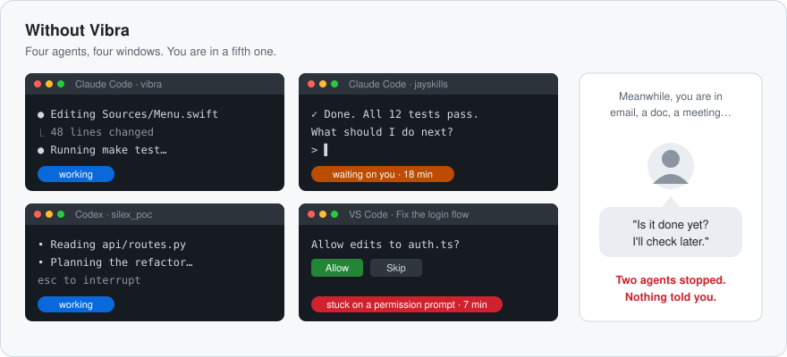
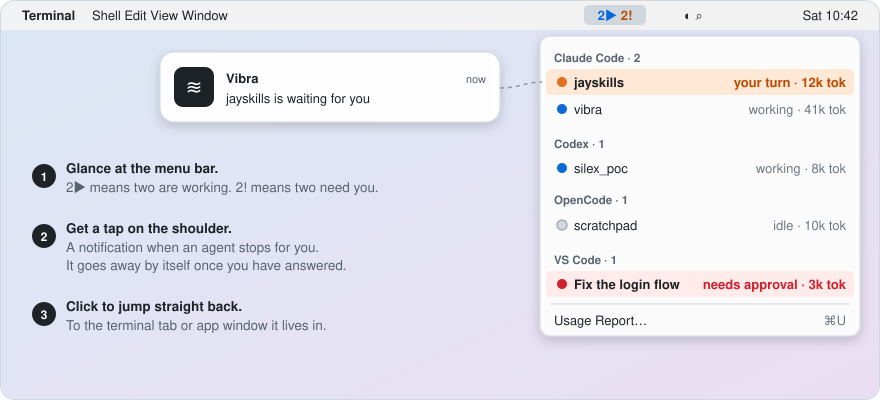
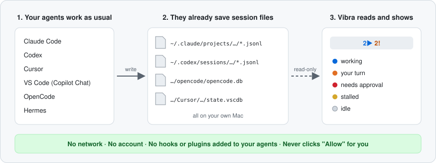

<h1 align="center">📳 Vibra</h1>

<p align="center">
  <strong>AI 코딩 에이전트가 10분 전에 작업을 끝냈습니다. 알아채셨나요?</strong>
</p>

<p align="center">
  <a href="LICENSE"></a>
  <a href="#설치"></a>
  <a href="docs/development.md"></a>
  <a href="#프라이버시"></a>
  <a href="https://github.com/silex-ai-lab/silex_vibra/stargazers"></a>
</p>

<p align="center">
  <a href="#문제">문제</a> · <a href="#빠른-시작">빠른 시작</a> · <a href="#지원하는-에이전트">지원하는 에이전트</a> · <a href="#프라이버시">프라이버시</a>
  <br>
  <a href="README.md">English</a> · <a href="README.zh-CN.md">简体中文</a> · <a href="README.ja.md">日本語</a> · 한국어
</p>

---

영어 README가 기준 문서이며, 이 번역은 최신 내용보다 늦을 수 있습니다.

## 문제

Claude Code에 작업을 맡기고, 그동안 다른 일을 합니다. 이어서 두 번째 작업은
Codex에, 세 번째 작업은 VS Code의 Copilot에 맡기기도 합니다. 그다음에는 보통
이런 일이 벌어집니다.

- **한 에이전트는 3분 만에 끝났는데, 20분 뒤에야 확인합니다.** 그중 17분 동안
  에이전트는 아무것도 하지 않고 기다렸습니다.
- **다른 에이전트는 30초 만에 멈추고 "이 파일을 수정해도 될까요?"라고 묻습니다.**
  대답하기 전까지는 아무것도 진행되지 않는데, 그 질문은 한참 뒤에야 눈에 들어옵니다.
- **상태를 확인하려고 터미널 탭과 창을 하나하나 눌러 봅니다.** 그것도 한 시간에
  여러 번씩.

<p align="center">
  
</p>

에이전트는 충돌로 실패하는 경우가 드뭅니다. 당신이 보고 있지 않은 창에서 조용히
기다리는 것으로 실패합니다. 동시에 돌리는 에이전트가 많을수록 이렇게 잃는 시간도
늘어납니다.

## Vibra가 하는 일

Vibra는 Mac의 메뉴 막대에 들어가는 작은 무료 앱입니다. 모든 에이전트 세션을
지켜보다가, 그중 하나가 당신을 필요로 하면 바로 알려 줍니다.

<p align="center">
  
</p>

| 문제 | Vibra를 쓰면 |
|---|---|
| 😴 에이전트가 끝났는데 몰랐다 | 해당 행이 🟠 **your turn**(당신 차례)으로 바뀌고 알림이 옵니다. 당신이 응답하면 알림은 사라집니다. |
| ✋ 에이전트가 "허용할까요?"에서 멈춰 있다 | 해당 행이 🔴 **needs approval**(승인 필요)로 바뀝니다. Vibra는 보여 주기만 합니다. 대신 허용을 누르는 일은 절대 없습니다. |
| 🔎 맞는 탭을 찾아 이리저리 뒤진다 | 행이나 알림을 클릭하면 해당 터미널 탭이나 앱 창으로 이동합니다. |
| 👀 어떤 에이전트가 아직 일하는 중인지 모르겠다 | 메뉴 막대에서 한눈에 보입니다. `2▶`는 두 개가 작업 중, `2!`는 두 개가 당신을 기다린다는 뜻입니다. |
| 🧾 이 작업에 얼마나 썼는지 궁금하다 | **Usage Report…**(⌘U)가 7일간의 토큰과, API 가격으로 치면 얼마인지를 보여 줍니다. |

모든 에이전트가 모든 상태를 보고하지는 않으며, 이동할 수 없는 에이전트도 있습니다.
에이전트별로 무엇이 되는지는 [지원하는 에이전트](#지원하는-에이전트) 표에 정확히 나와 있습니다.

> ⭐ **이 저장소에 Star를** 눌러 두면 새 에이전트 지원과 수정 사항을 놓치지 않습니다. 에이전트가 세션 파일을 바꾸면 제가 Vibra를 고치니 직접 챙기지 않아도 됩니다. [Star할 이유 →](#-vibra에-star할-이유)

## 작동 방식

이 에이전트들은 모두 이미 대화 내용을 Mac의 파일에 저장합니다. Vibra는 그 파일을
읽기 전용으로 읽고, 각 세션이 어떤 상태인지 판단합니다. 그게 전부입니다.
네트워크로 아무것도 보내지 않고, 에이전트에 아무것도 설치하지 않습니다.

<p align="center">
  
</p>

### ✅ 설치하기 전에

| | |
|---|---|
| 💰 **무료 오픈 소스** | Apache License 2.0. |
| 🔒 **로컬 전용** | 네트워크 전송이 전혀 없습니다. 계정 없음, 원격 측정 없음, 업데이트 확인 없음. |
| 🧩 **에이전트에 아무것도 설치하지 않음** | 훅, 플러그인, 상태 표시줄, 래퍼 바이너리가 없습니다. |
| 🤖 **6개 에이전트** | Claude Code, Codex, Cursor, VS Code(Copilot Chat), OpenCode, Hermes. 모든 에이전트가 모든 상태를 보고할 수 있는 것은 아닙니다. 자세한 내용은 [지원하는 에이전트](#지원하는-에이전트). |
| 🩺 **자가 점검** | 클론한 저장소에서 `make probe`를 실행하면 세션과 상태를 출력하며, 메시지 내용은 절대 출력하지 않습니다. |
| ⚠️ **소스에서 빌드** | 아직 내려받을 수 있는 앱이 없습니다. Vibra는 ad-hoc 서명이며 공증되지 않아, 알림을 받으려면 '시스템 설정'에서 한 번 수동으로 설정해야 합니다. |

## 빠른 시작

### 설치

**macOS 14 이상**과 Swift 6 툴체인이 필요합니다. **Xcode는 필요하지 않습니다.**
Command Line Tools로 충분합니다.

```sh
xcode-select --install     # skip if `swift --version` already works
```

그다음:

```sh
git clone https://github.com/silex-ai-lab/silex_vibra.git
cd silex_vibra
make install               # builds, then copies to /Applications
open /Applications/Vibra.app
```

`make install`은 실행 중인 복사본을 먼저 종료하므로, 변경 사항을 가져온 뒤
다시 실행해도 안전합니다.

Vibra에는 Dock 아이콘도 창도 없습니다. **메뉴 막대 항목이 앱의 전부입니다.**
메뉴 막대 오른쪽에서 `Vibra`를 찾거나, 세션이 살아 있을 때는 `2▶ 1!` 같은
숫자를 찾으세요.

완전히 제거하려면:

```sh
make uninstall
```

### 첫 실행

macOS가 확인되지 않은 개발자의 앱이라고 경고할 수 있습니다. Developer ID 서명이
아니라 ad-hoc 서명이기 때문입니다. Finder에서 앱을 오른쪽 클릭하고 **열기**를
한 번 선택하거나, 다음을 실행하세요.

```sh
xattr -dr com.apple.quarantine /Applications/Vibra.app
```

앱이 공증되지 않았기 때문에, 알림을 받으려면 '시스템 설정'에서 한 번 수동으로
설정해야 합니다. 자세한 내용은 [문제 해결](docs/troubleshooting.md#troubleshooting).

### 첫 2분

1. Vibra를 엽니다. 최근 12시간 동안 에이전트를 쓰지 않았다면 `No active sessions`로
   표시됩니다. 정상입니다.
2. 터미널에서 대화형 **Claude Code** 또는 **Codex** 세션을 시작하고 작업을
   맡기세요. 해당 행에 🔵 working(작업 중)이 표시됩니다.
3. 턴이 끝날 때까지 두세요. 행이 🟠 your turn(당신 차례)으로 바뀌고 메뉴 막대에
   `1!`가 표시됩니다.

터미널이 더 편하다면, 클론한 저장소에서 `make probe`를 실행하세요. 세션과 상태를
출력하며 메시지 내용은 절대 출력하지 않습니다. 세션을 하나도 찾지 못하면 종료 코드
`2`로 끝납니다.

## 지원하는 에이전트

| 에이전트 가이드 | 지원 범위 | 🔵 | 🟠 | 🔴 | 🟡 | ⚪️ |
|---|---|---|---|---|---|---|
|  [Claude Code](docs/agents/claude-code.md) | CLI, Claude 데스크톱 앱, VS Code / Cursor 확장 | ✓ | ✓ | ✓ | ✓ | ✓ |
|  [Codex](docs/agents/codex.md) | CLI, `codex exec`, 데스크톱 앱, IDE 확장 | live | live | — | ✓ | ✓ |
| <picture><source media="(prefers-color-scheme: dark)" srcset="docs/assets/agents/cursor-for-dark.svg"></picture> [Cursor](docs/agents/cursor.md) | Agents 창과 편집기 채팅 | live | ✓ | ✓ | — | live |
| <picture><source media="(prefers-color-scheme: dark)" srcset="docs/assets/agents/githubcopilot-for-dark.svg"></picture> [VS Code](docs/agents/vscode.md) | GitHub Copilot Chat(Ask, Edit, Agent 모드), Insiders 포함 | live | live | live | ✓ | live |
| <picture><source media="(prefers-color-scheme: dark)" srcset="docs/assets/agents/opencode-for-dark.svg"></picture> [OpenCode](docs/agents/opencode.md) | DeepSeek 포함 | ✓ | — | ✓ | — | ✓ |
| <picture><source media="(prefers-color-scheme: dark)" srcset="docs/assets/agents/hermesagent-for-dark.svg"></picture> [Hermes](docs/agents/hermes.md) | CLI 및 채팅 게이트웨이 | ✓ | ✓ | — | ✓ | ✓ |

**live**: 기록된 실제 세션에서 관찰됨. **✓**: 코드로는 표시할 수 있지만 아직 라이브
기록이 없음(픽스처 테스트가 다루는지는 가이드에 나와 있음). **—**: 표시되지 않음
(예: Codex와 Hermes에는 승인 상태가 없음).

행을 클릭하면 Claude Code와 Codex는 터미널 탭(iTerm2, Terminal, herdr)이나 호스트 앱으로,
VS Code는 해당 창으로 이동하고, Cursor는 앞으로 가져옵니다. OpenCode와 Hermes 세션은
이동할 수 없습니다.

### 색상의 의미

| 상태 | 의미 |
|---|---|
| 🔵 작업 중 (working) | 출력을 생성 중입니다. 그대로 두세요. |
| 🟠 당신 차례 (your turn) | 턴을 마치고 당신을 기다립니다. |
| 🔴 승인 필요 (needs approval) | 권한 프롬프트에서 기다리고 있습니다. |
| 🟡 정체됨 (stalled) | 턴 중이라고 했다가 조용해졌습니다. |
| ⚪️ 유휴 (idle) | 정리되었고 대기 중인 것이 없습니다. |

## 그 밖의 기능

- **Usage Report…**(⌘U): 7일간의 토큰과 API 환산 가치. Claude Code와 Codex는
  날짜별로 보여 주며, Claude Code 세션에서 무엇이 가장 비용을 많이 썼는지에 대한
  팁도 제공합니다.
- **History…**(⌘Y): 당신이 에이전트에게 물은 질문.
- **`--query`**: 메뉴를 JSON으로 출력. 스크립트용입니다.

자세한 내용: [기능](docs/features.md).

## 설계 원칙

- **수동적 읽기 도구.** Vibra는 이 도구들에게 기록 내용을 바꾸라고 요구하지 않습니다.
  이미 존재하는 파일을 읽기만 합니다.
- **보여 주기만 하고 행동하지 않음.** 에이전트의 권한 프롬프트를 대신 승인하지 않습니다.
  보여 주기만 합니다.
- **본 것을 그대로 말함.** 위 표는 기록된 라이브 세션에서 관찰한 상태(**live**)와
  코드가 표시할 수 있지만 라이브 기록이 아직 없는 상태(**✓**)를 구분합니다.

## 프라이버시

Vibra는 로컬 파일을 읽고 아무 데도 전송하지 않습니다. 에이전트가 이미 기록하는
세션 파일과 데이터베이스를 수동적으로 읽기만 합니다(경로는 각 가이드 참조).

- **네트워크 전송이 전혀 없습니다.** 계정 없음, 원격 측정 없음, 업데이트 확인 없음.
- **에이전트에 아무것도 설치하지 않습니다.** 훅, 플러그인, 상태 표시줄, 래퍼 바이너리가
  없습니다.
- OpenCode와 Cursor의 데이터베이스에는 인증 토큰이 있습니다. 각각 읽기 전용으로 열고
  하드코딩된 `SELECT` 하나만 실행하며, 토큰 테이블은 조회하지 않습니다.
- `--query`, `--probe` 및 기타 기계 판독용 출력에는 메시지 텍스트가 포함되지 않습니다.
  입력한 내용을 보여 주는 유일한 기능인 History는 창이 열려 있는 동안에만 메모리에
  보관하고, 아무것도 기록하지 않습니다.
- 에이전트의 권한 프롬프트를 대신 승인하지 않습니다. 보여 주기만 합니다.

**카나리 테스트**는 테스트 픽스처에 가짜 비밀과 메시지 텍스트를 심고, 그것이 반환되는
세션, 그 JSON, `--query` 출력, 오류 어디에도 나타나지 않는지 검증합니다(어댑터별).
OpenCode 토큰 카나리가 실행되지 않으면 `make test`가 실패합니다.
자세한 내용: [docs/privacy.md](docs/privacy.md).

## ⭐ Vibra에 Star할 이유

저도 매일 Vibra로 제 에이전트들을 지켜보고 있어서 계속 유지보수합니다.

- 새 에이전트나, 이미 지원하는 에이전트의 새 상태를 원하는 분이 있으면 추가합니다.
- 모든 에이전트를 **무료로, 로컬에서만, 제대로 동작하게** 유지합니다. 계정도 유료 버전도 없고, 아무것도 외부로 보내지 않습니다.
- 에이전트는 Vibra가 읽는 세션 파일을 계속 바꿉니다. 업데이트로 읽지 못하게 되면 제가 어댑터를 고치니, 직접 챙기지 않아도 됩니다.

이유가 더 있습니다.

- 🔒 **프라이버시는 약속이 아니라 테스트로 지킵니다.** 카나리 테스트가 가짜 비밀 정보와 메시지 본문을 심어 두고, 그중 하나라도 Vibra의 출력에 새어 나오면 빌드가 실패합니다.
- 🧾 **되는 것만 정직하게 표시합니다.** 호환성 표에서 실제 세션에서 확인한 상태(**live**)와, 코드로는 표시할 수 있지만 아직 아무도 확인하지 못한 상태(**✓**)를 따로 표시합니다.
- 🧩 **기존 설정을 건드리지 않습니다.** 에이전트에 훅, 플러그인, 래퍼를 추가하지 않고, `make uninstall`로 앱을 제거할 수 있습니다.
- 🌏 **4개 언어로 읽을 수 있습니다.** English, 简体中文, 日本語, 한국어.
- 📣 **다른 사람이 찾기 쉬워집니다.** Star가 있으면 여러 에이전트를 동시에 돌리는 다른 사람도 Vibra를 더 쉽게 찾을 수 있습니다.

에이전트가 한참 기다리고 있는데 몰랐던 순간, 다음에 Vibra를 바로 찾을 수 있도록 Star해 두세요. ⭐

## 더 보기 및 기여

[기능](docs/features.md) · [문제 해결 및 제한 사항](docs/troubleshooting.md) ·
[개발](docs/development.md) · [변경 내역](CHANGELOG.md) · [로드맵](docs/ROADMAP.md)

이슈와 풀 리퀘스트를 환영합니다. 테스트는 `swift test`가 아니라 `make test`로
실행하세요. Xcode가 없는 머신에서 `swift test`는 테스트를 하나도 실행하지 않습니다.

## 라이선스

[Apache License 2.0](LICENSE)

호환성 표의 에이전트 마크는 [docs/assets/agents/ATTRIBUTION.md](docs/assets/agents/ATTRIBUTION.md)를 참조하세요.
