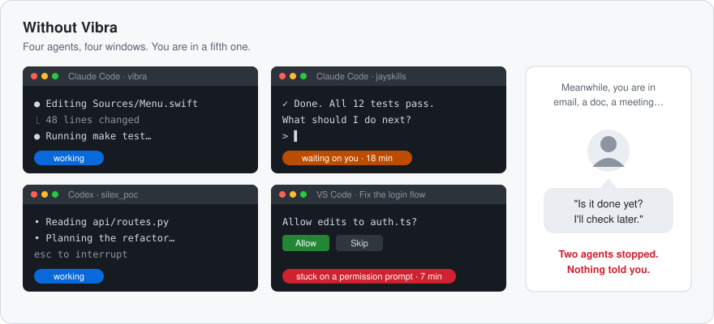
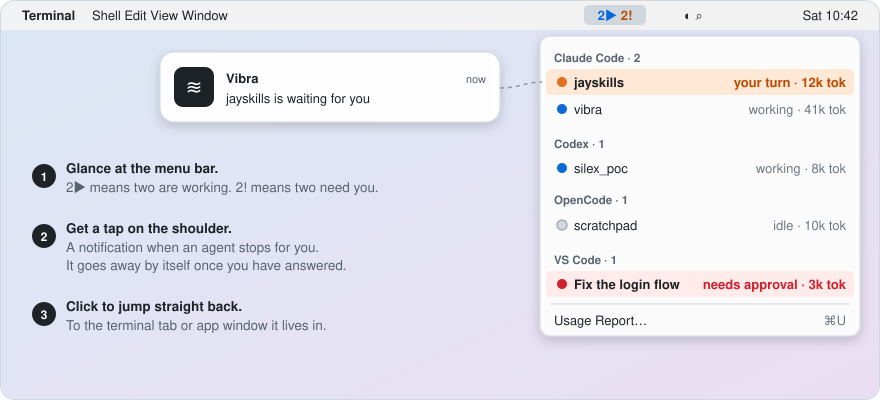
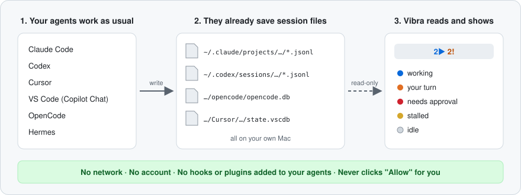

<h1 align="center">📳 Vibra</h1>

<p align="center">
  <strong>Your AI coding agent finished ten minutes ago. Did you notice?</strong>
</p>

<p align="center">
  <a href="LICENSE"></a>
  <a href="#install"></a>
  <a href="docs/development.md"></a>
  <a href="#privacy"></a>
  <a href="https://github.com/silex-ai-lab/silex_vibra/stargazers"></a>
</p>

<p align="center">
  <a href="#the-problem">The problem</a> · <a href="#quick-start">Quick start</a> · <a href="#supported-agents">Supported agents</a> · <a href="#privacy">Privacy</a>
  <br>
  English · <a href="README.zh-CN.md">简体中文</a> · <a href="README.ja.md">日本語</a> · <a href="README.ko.md">한국어</a>
</p>

---

## The problem

You give Claude Code a task and switch to something else while it works. Then
you start Codex on a second task, and maybe Copilot in VS Code on a third.
Here is what usually happens next.

- **One agent finishes in three minutes. You check back after twenty.** It sat
  there doing nothing for seventeen of them.
- **Another one stops after thirty seconds to ask "May I edit this file?"**
  Nothing moves until you answer, and you don't see the question until much later.
- **To find out, you click through every terminal tab and window.** One by one,
  several times an hour.

<p align="center">
  
</p>

Agents rarely fail by crashing. They fail by waiting quietly in a window you
are not looking at. The more agents you run at once, the more time you lose
this way.

## What Vibra does about it

Vibra is a small, free app that lives in your Mac's menu bar. It keeps an eye
on all your agent sessions and tells you as soon as one of them needs you.

<p align="center">
  
</p>

| The problem | With Vibra |
|---|---|
| 😴 An agent finished and you didn't notice | Its row turns 🟠 **your turn** and you get a notification. The notification disappears once you have answered. |
| ✋ An agent is stuck on "Allow this?" | Its row turns 🔴 **needs approval**. Vibra only shows it. It never clicks Allow for you. |
| 🔎 You hunt through tabs for the right one | Click the row or the notification to jump to its terminal tab or app window. |
| 👀 You can't tell which agents are still busy | The menu bar shows it at a glance. `2▶` means two are working, `2!` means two need you. |
| 🧾 You wonder what all this work used | **Usage Report…** (⌘U) shows 7 days of tokens and what they would cost at API prices. |
| 🛡️ An agent did something you did not sanction | **Review Agent Activity…** lists denied calls that ran later, credential reads, writes outside the workspace, force pushes and unrestricted sessions. You answer each one, or draft a report to the vendor and send it yourself. |

Not every agent reports every state, and some cannot be jumped to. The
[Supported agents](#supported-agents) table shows exactly what works for each one.

> ⭐ **Star this repo** to keep up with new agents and fixes. When an agent changes its session files, I update Vibra so you don't have to. [Why star it →](#-why-star-vibra)

## How it works

Each of these agents already saves its conversation to files on your Mac. Vibra
reads those files, read-only, and works out what state each session is in.
That's all. It sends nothing over the network and installs nothing into your
agents.

<p align="center">
  
</p>

### ✅ Before you install

| | |
|---|---|
| 💰 **Free and open source** | Apache License 2.0. |
| 🔒 **Local-only** | No network traffic at all. No account, no telemetry, no update check. |
| 🧩 **Installs nothing into your agents** | No hooks, no plugins, no statusline, no wrapper binaries. |
| 🤖 **Six agents** | Claude Code, Codex, Cursor, VS Code (Copilot Chat), OpenCode and Hermes. Not every agent can report every state; see [Supported agents](#supported-agents). |
| 🩺 **Self-check** | `make probe` in the cloned repo prints sessions and states, never message content. |
| ⚠️ **Build from source** | There is no downloadable app yet. Vibra is ad-hoc signed and not notarized, so notifications need one manual System Settings step. |

## Quick start

### Install

#### Homebrew

Vibra is free to install and use under the [Apache-2.0 license](LICENSE).
Both this repository and the official tap are public. No GitHub account,
invitation, or repository access approval is needed.

Apple Silicon and Intel Macs are supported. CI builds, tests and launches the
app on every push, on macOS 15 with Swift 6.1.2, on both Apple Silicon and
Intel. Check `swift --version` before installing. If Swift is missing, run `xcode-select --install`. If it is older
than Swift 6.1, update the Command Line Tools through Software Update.

With [Homebrew](https://brew.sh), macOS 14 or later, and Swift 6.1 or later:

```sh
brew install silex-ai-lab/tap/vibra
open "$(brew --prefix vibra)/Vibra.app"
```

The [official tap](https://github.com/silex-ai-lab/homebrew-tap) builds from a
checksum-verified source archive. Command Line Tools are enough; Xcode is not
required. It also installs `vibra --query` for scripts.

Quit an older Vibra copy before launching the Homebrew app. Homebrew does not
replace `/Applications/Vibra.app` or update login items. This build is ad-hoc
signed and not notarized. See the tap's [migration and signing notes](https://github.com/silex-ai-lab/homebrew-tap#switch-from-a-manual-installation).

Quit Vibra before updating with `brew upgrade silex-ai-lab/tap/vibra`. To
remove Vibra and its saved data, see [Removing Vibra](#removing-vibra).

#### Manual source build

You need **macOS 14 or later** and Swift 6.1 or later. **You do not need
Xcode.** The Command Line Tools are enough:

```sh
xcode-select --install     # skip if `swift --version` already works
```

Then:

```sh
git clone https://github.com/silex-ai-lab/silex_vibra.git
cd silex_vibra
make install               # builds, then copies to /Applications
open /Applications/Vibra.app
```

`make install` quits any running copy first, so you can safely run it again
after pulling changes.

Vibra has no Dock icon. **It starts from the menu bar item**, and its windows,
such as Setup, Session Details and Review Agent Activity, open from that menu.
Look on the right-hand side of your menu bar for `Vibra`, or for a count such
as `2▶ 1!` when sessions are live.

### Removing Vibra

Quit Vibra first. Then remove the app the way you installed it:

```sh
brew uninstall silex-ai-lab/tap/vibra   # Homebrew
make uninstall                          # manual build, from the repository
```

Either one leaves saved data behind: your answers in the Review Agent Activity
window and Vibra's settings. To remove those too:

```sh
rm -rf ~/Library/Application\ Support/Vibra
defaults delete ai.silexlab.vibra
```

### First launch

Vibra is ad-hoc signed rather than Developer ID signed. If macOS blocks it,
review the app in **System Settings > Privacy & Security** before choosing
**Open Anyway**. The Homebrew app is at `$(brew --prefix vibra)/Vibra.app`;
a manual installation is at `/Applications/Vibra.app`.


Notifications need one manual step in System Settings, because the app is not
notarized. See [Troubleshooting](docs/troubleshooting.md#troubleshooting).

### Your first two minutes

1. Open Vibra. The **Setup** window shows what it found for each agent, the
   notification state, and a **Launch Vibra at login** option; close it, or
   press **Start Using Vibra**. If you have not used an agent in the last 12
   hours, the menu then reads `No active sessions`; on a Mac with no agent data
   yet it reads `No sessions yet`. Both are expected.
2. In a terminal, start an interactive **Claude Code** or **Codex** session and
   give it a task. Its row shows 🔵 working.
3. Let the turn finish. The row turns 🟠 your turn and the menu bar shows `1!`.

Prefer the terminal? `make probe` in the cloned repo prints sessions and
states, never message content. It exits with code `2` if it finds none.

## Supported agents

| Agent guide | Covers | 🔵 | 🟠 | 🔴 | 🟡 | ⚪️ |
|---|---|---|---|---|---|---|
|  [Claude Code](docs/agents/claude-code.md) | CLI, Claude desktop app, VS Code / Cursor extension | ✓ | ✓ | ✓ | ✓ | ✓ |
|  [Codex](docs/agents/codex.md) | CLI, `codex exec`, desktop app, IDE extension | live | live | — | ✓ | ✓ |
| <picture><source media="(prefers-color-scheme: dark)" srcset="docs/assets/agents/cursor-for-dark.svg"></picture> [Cursor](docs/agents/cursor.md) | Agents window and editor chat | live | ✓ | ✓ | — | live |
| <picture><source media="(prefers-color-scheme: dark)" srcset="docs/assets/agents/githubcopilot-for-dark.svg"></picture> [VS Code](docs/agents/vscode.md) | GitHub Copilot Chat (Ask, Edit, Agent mode), also Insiders | live | live | live | ✓ | live |
| <picture><source media="(prefers-color-scheme: dark)" srcset="docs/assets/agents/opencode-for-dark.svg"></picture> [OpenCode](docs/agents/opencode.md) | incl. DeepSeek | ✓ | — | ✓ | — | ✓ |
| <picture><source media="(prefers-color-scheme: dark)" srcset="docs/assets/agents/hermesagent-for-dark.svg"></picture> [Hermes](docs/agents/hermes.md) | CLI and chat gateways | ✓ | ✓ | — | ✓ | ✓ |

**live**: seen in a recorded real session. **✓**: the code can show it, but no
live record yet (the guide says if a fixture test covers it). **—**: never
shown (for example, Codex and Hermes have no approval state).

Clicking a row jumps to the terminal tab (iTerm2, Terminal, herdr, Orca) or hosting
app for Claude Code and Codex, to the VS Code window, or brings Cursor forward.
OpenCode and Hermes sessions cannot be jumped to: clicking one opens its details
instead.

### What the colours mean

| State | Meaning |
|---|---|
| 🔵 working | Busy producing output. Leave it alone. |
| 🟠 your turn | Finished its turn and waiting for you. |
| 🔴 needs approval | Waiting on a permission prompt. |
| 🟡 stalled | Said it was mid-turn, then went silent. |
| ⚪️ idle | Settled, nothing pending. |

## More it can do

- **Usage Report…** (⌘U): 7 days of tokens and API-equivalent value, by day
  for Claude Code and Codex, plus tips on what cost your Claude Code sessions
  the most.
- **History…** (⌘Y): the questions you asked your agents.
- **Code checks** in Session Details (Claude Code and Codex): whether a test,
  build or lint command ran after the session's last code change, and what it
  returned. It never says a task is done. See
  [features](docs/features.md#the-menu).
- **Review Agent Activity…** (Claude Code and Codex): findings such as
  credential reads or writes outside the workspace, each for you to answer or
  report to the vendor yourself.
- **`--query`**: the menu as JSON, for scripts.

Details: [features](docs/features.md).

## Design principles

- **A passive reader.** Vibra never asks these tools to change what they write.
  It only reads files that already exist.
- **Shows, never acts.** It never approves an agent's permission prompt for you.
  It only shows it.
- **Says what it has seen.** The table above keeps states seen in a recorded
  live session (**live**) apart from states the code can show with no live
  record yet (**✓**).

## Privacy

Vibra reads local files and sends nothing anywhere. It is a passive reader of
the session files and databases the agents already write (paths in each guide).

- **No network traffic at all.** No account, no telemetry, no update check.
- **It installs nothing into your agents.** No hooks, no plugins, no
  statusline, no wrapper binaries.
- OpenCode's and Cursor's databases hold auth tokens. Each is opened read-only
  with one hard-coded `SELECT`, and the token tables are never queried.
- `--query`, `--probe` and the other machine-readable outputs never contain
  message text. History, the one feature that shows what you typed, keeps it in
  memory only while its window is open and writes nothing.
- It never approves an agent's permission prompt for you. It only shows it.
- The incident monitor reads tool activity in Claude Code and Codex transcripts,
  keeps only closed values, and writes hashed ids and your answers to
  `~/Library/Application Support/Vibra/incidents.json`. A report to a vendor is a
  local draft that only you can send.

**Canary tests** plant fake secrets and message text in test fixtures and check
that none of it shows up in returned sessions, their JSON, `--query` output or
errors (per adapter). `make test` fails if the OpenCode token canary did not
run. Detail: [docs/privacy.md](docs/privacy.md).

## ⭐ Why star Vibra

I use Vibra every day to keep track of my own agents, so I keep maintaining it.

- When people ask for a new agent, or a new state for one we already support, I add it.
- I keep every agent **free, local and working**: no account, no paid tier, nothing sent anywhere.
- Agents keep changing the session files Vibra reads. When an update breaks one, I fix the adapter so you don't have to watch for it.

More reasons:

- 🔒 **Privacy is tested, not promised.** Canary tests plant fake secrets and message text, then fail the build if any of it leaks into Vibra's output.
- 🧾 **Honest about what works.** The compatibility table marks what has been seen in a real session (**live**) separately from what the code can show but nobody has seen yet (**✓**).
- 🧩 **Leaves your setup alone.** It adds no hooks, plugins or wrappers to your agents, and `make uninstall` removes the app.
- 🌏 **Readable in four languages:** English, 简体中文, 日本語 and 한국어.
- 📣 **Helps other people find it.** A star makes Vibra easier to find for anyone else running several agents at once.

Star it so you can find it the next time an agent has been waiting on you without you noticing. ⭐

## More and contributing

[Features](docs/features.md) · [Troubleshooting & limitations](docs/troubleshooting.md) ·
[Development](docs/development.md) · [Changelog](CHANGELOG.md) · [Roadmap](docs/ROADMAP.md)

Issues and pull requests are welcome. Run the tests with `make test`, not
`swift test`, which runs zero tests on a machine without Xcode.

## License

[Apache License 2.0](LICENSE)

Agent marks in the compatibility table: see [docs/assets/agents/ATTRIBUTION.md](docs/assets/agents/ATTRIBUTION.md).
