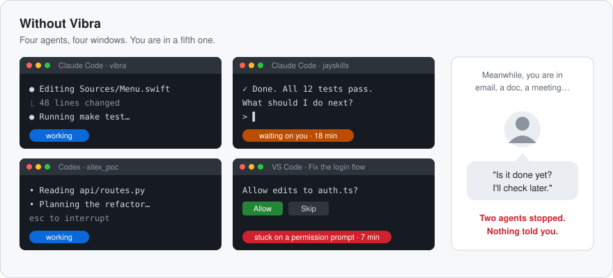
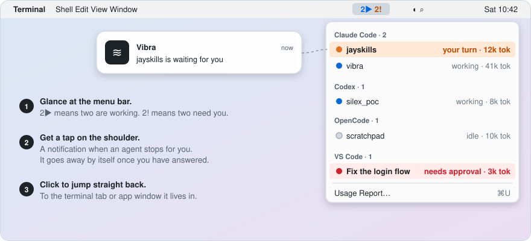
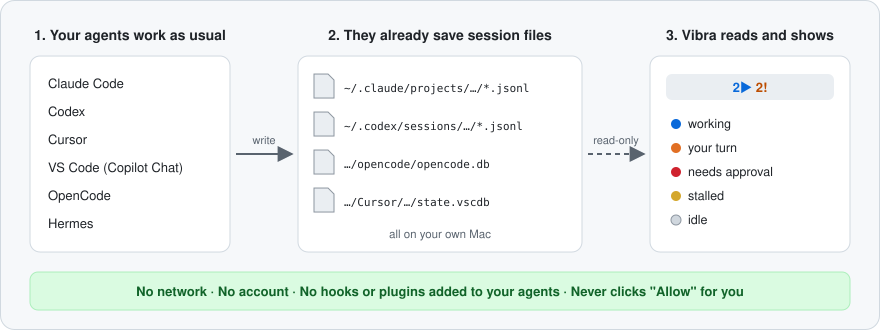

<h1 align="center">📳 Vibra</h1>

<p align="center">
  <strong>你的 AI 编码 Agent 十分钟前就干完了。你发现了吗？</strong>
</p>

<p align="center">
  <a href="LICENSE"></a>
  <a href="#安装"></a>
  <a href="docs/development.md"></a>
  <a href="#隐私"></a>
  <a href="https://github.com/silex-ai-lab/silex_vibra/stargazers"></a>
</p>

<p align="center">
  <a href="#问题所在">问题所在</a> · <a href="#快速开始">快速开始</a> · <a href="#支持的-agent">支持的 Agent</a> · <a href="#隐私">隐私</a>
  <br>
  <a href="README.md">English</a> · 简体中文 · <a href="README.ja.md">日本語</a> · <a href="README.ko.md">한국어</a>
</p>

---

英文版 README 为权威版本，本译文可能滞后。

## 问题所在

你给 Claude Code 派了个任务，趁它干活，你切去做别的事。接着你又让 Codex
跑第二个任务，说不定还在 VS Code 里让 Copilot 跑第三个。接下来通常是这样的：

- **一个 Agent 三分钟就干完了，你二十分钟后才回来看。** 它白白闲了十七分钟。
- **另一个跑了三十秒就停下来问：“可以编辑这个文件吗？”**
  你不回答，它就一动不动，而你很久以后才看到这个问题。
- **为了弄清状况，你得把每个终端标签页和窗口挨个点一遍。** 一个一个看，一小时要看好几回。

<p align="center">
  
</p>

Agent 很少因为崩溃而出问题。它们出问题的方式，是在你没看的那个窗口里默默等着。
你同时跑的 Agent 越多，这样白白浪费的时间就越多。

## Vibra 怎么解决

Vibra 是一个住在 Mac 菜单栏里的免费小应用。它替你盯着所有 Agent 会话，
哪个需要你了，就马上告诉你。

<p align="center">
  
</p>

| 问题 | 有了 Vibra |
|---|---|
| 😴 Agent 干完了，你没发现 | 它那一行变成 🟠 **your turn**（轮到你），你会收到通知。你回应之后，通知自动消失。 |
| ✋ Agent 卡在“允许吗？”上 | 它那一行变成 🔴 **needs approval**（需要批准）。Vibra 只负责显示，绝不替你点“允许”。 |
| 🔎 你在一堆标签页里找它 | 点一下那一行或那条通知，就跳到对应的终端标签页或应用窗口。 |
| 👀 你分不清哪些 Agent 还在忙 | 看一眼菜单栏就知道。`2▶` 表示两个正在工作，`2!` 表示两个在等你。 |
| 🧾 你好奇这些工作用了多少 | **Usage Report…**（⌘U）显示 7 天的 token 用量，以及按 API 价格算要花多少钱。 |

并不是每个 Agent 都能上报每一种状态，有些也没法跳转过去。
[支持的 Agent](#支持的-agent) 表格写清了每个 Agent 具体能做到什么。

> ⭐ **Star 这个项目**，新 Agent 和修复不会错过。Agent 改了会话文件，我来改 Vibra，你不用自己盯。[为什么值得 Star →](#-为什么值得-star)

## 工作原理

这些 Agent 本来就会把对话保存成你 Mac 上的文件。Vibra 以只读方式读取这些文件，
判断出每个会话处于什么状态。就这么简单。它不通过网络发送任何东西，
也不往你的 Agent 里安装任何东西。

<p align="center">
  
</p>

### ✅ 安装前须知

| | |
|---|---|
| 💰 **免费且开源** | Apache License 2.0。 |
| 🔒 **仅本地** | 完全没有网络流量。无账号、无遥测、不检查更新。 |
| 🧩 **不向你的 Agent 安装任何东西** | 没有 hook、没有插件、没有 statusline、没有包装二进制文件。 |
| 🤖 **六个 Agent** | Claude Code、Codex、Cursor、VS Code（Copilot Chat）、OpenCode 和 Hermes。并非每个 Agent 都能上报每一种状态；见 [支持的 Agent](#支持的-agent)。 |
| 🩺 **自检** | 在克隆下来的仓库里运行 `make probe`，会打印会话和状态，绝不打印消息内容。 |
| ⚠️ **从源码构建** | 目前还没有可下载的应用。Vibra 采用 ad-hoc 签名，未做公证，因此通知需要在“系统设置”里手动操作一步。 |

## 快速开始

### 安装

#### Homebrew

任何人都可以依据 [Apache-2.0 许可证](LICENSE) 免费安装和使用 Vibra。
本仓库和官方 tap 均为公开仓库，不需要 GitHub 账号、邀请或仓库访问授权。

支持 Apple Silicon 和 Intel Mac。安装前请运行 `swift --version`，确认版本为 Swift 6 或更高。
如果没有 Swift，请先运行 `xcode-select --install`；如果版本过旧，请通过“软件更新”更新 Command Line Tools。

已安装 [Homebrew](https://brew.sh)，并具备 macOS 14 或更高版本及 Swift 6 或更高版本时：

```sh
brew install silex-ai-lab/tap/vibra
open "$(brew --prefix vibra)/Vibra.app"
```

[官方 tap](https://github.com/silex-ai-lab/homebrew-tap) 会下载带 SHA-256 校验的源码归档并在本机编译。
只需 Command Line Tools，不需要完整 Xcode。安装后也可以使用 `vibra --query` 查询状态。

启动前请退出旧版 Vibra。Homebrew 不会覆盖 `/Applications/Vibra.app`，也不会修改登录项。
该版本仍采用 ad-hoc 签名，未做公证。迁移和权限限制见 [tap 说明](https://github.com/silex-ai-lab/homebrew-tap#switch-from-a-manual-installation)。

更新前先退出 Vibra，再运行 `brew upgrade silex-ai-lab/tap/vibra`。
卸载使用 `brew uninstall silex-ai-lab/tap/vibra`。

#### 手动从源码构建

需要 **macOS 14 或更高版本** 和 Swift 6 工具链。**不需要 Xcode。**
有 Command Line Tools 就够了：

```sh
xcode-select --install     # skip if `swift --version` already works
```

然后：

```sh
git clone https://github.com/silex-ai-lab/silex_vibra.git
cd silex_vibra
make install               # builds, then copies to /Applications
open /Applications/Vibra.app
```

`make install` 会先退出正在运行的副本，因此拉取更新后可以放心重跑。

Vibra 没有 Dock 图标，也没有窗口。**菜单栏项目就是整个应用。**
在菜单栏右侧找 `Vibra`，有会话活跃时则是像 `2▶ 1!` 这样的计数。

完整删除：

```sh
make uninstall
```

### 首次启动

Vibra 采用 ad-hoc 签名，而不是 Developer ID 签名。如果 macOS 阻止打开，
请先在 **系统设置 > 隐私与安全性** 中检查应用，再决定是否选择 **仍要打开**。
Homebrew 版本位于 `$(brew --prefix vibra)/Vibra.app`，手动安装的版本位于 `/Applications/Vibra.app`。


因为应用没有做公证，通知需要在“系统设置”里手动操作一步。见
[疑难解答](docs/troubleshooting.md#troubleshooting)。

### 你的最初两分钟

1. 打开 Vibra。**Setup** 窗口会显示在每个 Agent 上发现了什么、通知状态，
   以及 **Launch Vibra at login** 选项；关闭它，或点击 **Start Using Vibra**。
   如果你最近 12 小时都没用过 Agent，菜单随后会显示 `No active sessions`；这台 Mac 上还没有任何 Agent 数据时会显示 `No sessions yet`。两者都正常。
2. 在终端里启动一个交互式 **Claude Code** 或 **Codex** 会话，
   给它一个任务。它那一行会显示 🔵 working（工作中）。
3. 等这一回合结束。该行变为 🟠 your turn（轮到你），菜单栏显示 `1!`。

更喜欢用终端？在克隆下来的仓库里运行 `make probe`，会打印会话和状态，
绝不打印消息内容。如果一个会话都没找到，退出码为 `2`。

## 支持的 Agent

| Agent 指南 | 覆盖范围 | 🔵 | 🟠 | 🔴 | 🟡 | ⚪️ |
|---|---|---|---|---|---|---|
|  [Claude Code](docs/agents/claude-code.md) | CLI、Claude 桌面应用、VS Code / Cursor 扩展 | ✓ | ✓ | ✓ | ✓ | ✓ |
|  [Codex](docs/agents/codex.md) | CLI、`codex exec`、桌面应用、IDE 扩展 | live | live | — | ✓ | ✓ |
| <picture><source media="(prefers-color-scheme: dark)" srcset="docs/assets/agents/cursor-for-dark.svg"></picture> [Cursor](docs/agents/cursor.md) | Agents 窗口和编辑器对话 | live | ✓ | ✓ | — | live |
| <picture><source media="(prefers-color-scheme: dark)" srcset="docs/assets/agents/githubcopilot-for-dark.svg"></picture> [VS Code](docs/agents/vscode.md) | GitHub Copilot Chat（Ask、Edit、Agent 模式），也支持 Insiders | live | live | live | ✓ | live |
| <picture><source media="(prefers-color-scheme: dark)" srcset="docs/assets/agents/opencode-for-dark.svg"></picture> [OpenCode](docs/agents/opencode.md) | 包含 DeepSeek | ✓ | — | ✓ | — | ✓ |
| <picture><source media="(prefers-color-scheme: dark)" srcset="docs/assets/agents/hermesagent-for-dark.svg"></picture> [Hermes](docs/agents/hermes.md) | CLI 和聊天网关 | ✓ | ✓ | — | ✓ | ✓ |

**live**：已在有记录的真实会话中见到。**✓**：代码能显示，但还没有实时记录（指南
会说明是否有夹具测试覆盖）。**—**：从不显示（例如 Codex 和 Hermes 没有批准状态）。

点击某一行时：Claude Code 和 Codex 会跳到终端标签页（iTerm2、Terminal、herdr）或宿主应用，
VS Code 会跳到对应窗口，Cursor 会被带到前台。OpenCode 和 Hermes 会话无法跳转：
点击这类行会打开它的详情。

### 颜色代表什么

| 状态 | 含义 |
|---|---|
| 🔵 working（工作中） | 正在产生输出。别打扰它。 |
| 🟠 your turn（轮到你） | 回合已结束，在等你。 |
| 🔴 needs approval（需要批准） | 停在权限提示上等你。 |
| 🟡 stalled（停滞） | 说自己进行到一半，然后没了动静。 |
| ⚪️ idle（空闲） | 已安定，没有待处理事项。 |

## 更多功能

- **Usage Report…**（⌘U）：7 天的 token 用量和等值 API 费用，Claude Code 和 Codex
  按天列出，另外还会提示你的 Claude Code 会话里哪些地方最花钱。
- **History…**（⌘Y）：你问过 Agent 的问题。
- **`--query`**：以 JSON 输出菜单，方便脚本使用。

详情：[功能说明](docs/features.md)。

## 设计原则

- **被动的读取者。** Vibra 从不要求这些工具改变它们写入的内容。
  它只读取已经存在的文件。
- **只显示，从不代替操作。** 它绝不替你批准 Agent 的权限提示，只负责显示。
- **只陈述它见到的。** 上表把在有记录的实时会话中见到的状态（**live**）
  与代码能显示但尚无实时记录的状态（**✓**）区分开。

## 隐私

Vibra 读取本地文件，不向任何地方发送任何东西。它被动读取
这些 Agent 本来就会写入的会话文件和数据库（路径见各指南）。

- **完全没有网络流量。** 无账号、无遥测、不检查更新。
- **它不向你的 Agent 安装任何东西。** 没有 hook、没有插件、没有
  statusline、没有包装二进制文件。
- OpenCode 和 Cursor 的数据库保存着认证 token。两者都以只读方式打开，
  只执行一条硬编码的 `SELECT`，绝不查询 token 表。
- `--query`、`--probe` 及其他机器可读输出绝不包含消息文本。
  History 是唯一会显示你输入内容的功能，它只在窗口打开期间把内容留在内存中，
  不写入任何东西。
- 它绝不替你批准 Agent 的权限提示，只负责显示。

**Canary 测试** 会在测试夹具中埋入假的密钥和消息文本，并检查它们都不会出现在
返回的会话、其 JSON、`--query` 输出或错误中（按适配器逐一检查）。如果
OpenCode token canary 没有运行，`make test` 会失败。详情：[docs/privacy.md](docs/privacy.md)。

## ⭐ 为什么值得 Star

这个项目我自己每天都在用，用它盯着我自己的那几个 Agent，所以我会一直维护它。

- 大家想要接入新的 Agent，或者给已支持的 Agent 加新状态，我会加上。
- 每个 Agent 我都会保证**免费、全本地、能用**：不用注册账号，没有付费版，任何数据都不发出去。
- Agent 总在改 Vibra 读取的会话文件。哪次升级让某个 Agent 读不了了，我来修适配器，你不用自己盯着。

还有更多理由：

- 🔒 **隐私靠测试保证，不只是口头承诺。** canary 测试会埋入假的密钥和消息内容，只要有任何一条泄漏到 Vibra 的输出里，构建就会失败。
- 🧾 **能做到什么就说什么。** 兼容性表把真实会话里见过的状态（**live**）和代码能显示但还没人实际见过的状态（**✓**）分开标。
- 🧩 **不动你的配置。** 不往 Agent 里装 hook、插件或包装程序，`make uninstall` 就能删掉 App。
- 🌏 **四种语言的说明：** English、简体中文、日本語 和 한국어。
- 📣 **让更多人找到它。** 一个 Star 能让其他同时跑好几个 Agent 的人更容易发现 Vibra。

Star 一下，下次 Agent 已经等了你半天你却没发现的时候，就能找到它。⭐

## 更多与贡献

[功能](docs/features.md) · [疑难解答与限制](docs/troubleshooting.md) ·
[开发](docs/development.md) · [更新日志](CHANGELOG.md) · [路线图](docs/ROADMAP.md)

欢迎提交 Issue 和 Pull Request。用 `make test` 运行测试，不要用
`swift test`：在没有 Xcode 的机器上它一个测试都不会运行。

## 许可证

[Apache License 2.0](LICENSE)

兼容性表中的 Agent 标识见 [docs/assets/agents/ATTRIBUTION.md](docs/assets/agents/ATTRIBUTION.md)。
